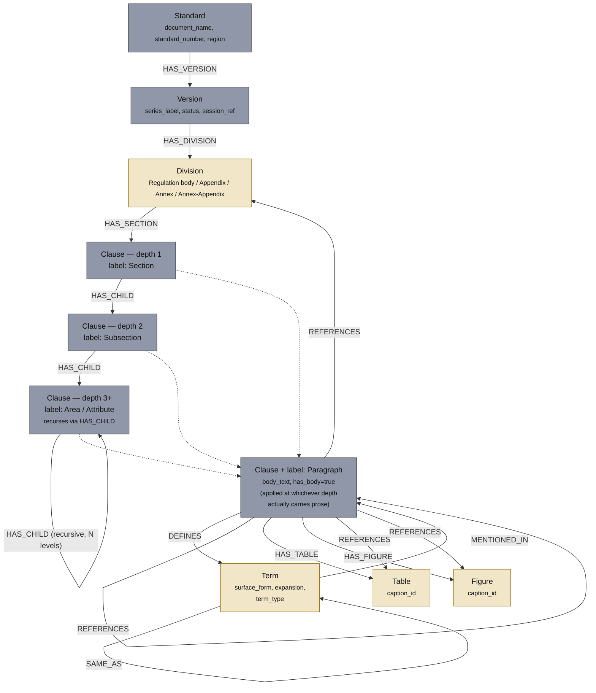
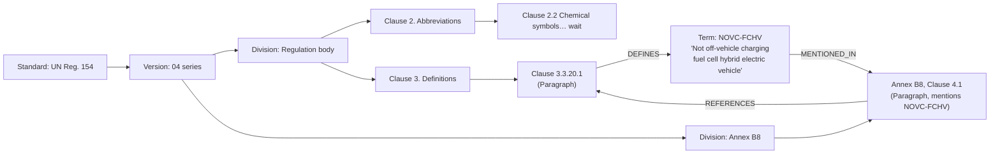
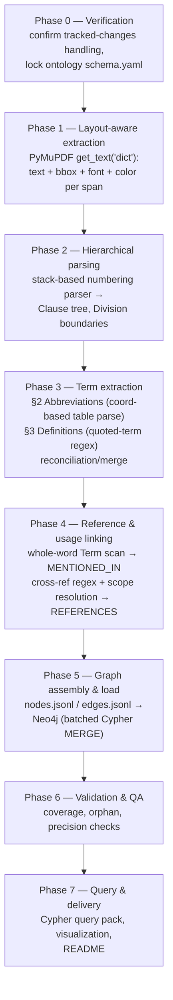

# Ontology-Based Knowledge Graph — Project Plan
**Source document:** `Document/154-04 without 1C 1.pdf` — UN Regulation No. 154 (WLTP), 04 series of amendments, ECE/TRANS/WP.29/GRPE/2025/15, 668 pages
**Ontology hierarchy reference:** `Ontology Nodes.png`
**Extraction constraint:** fully deterministic (regex / layout-geometry rules). No LLM, no NER model, no embeddings anywhere in the pipeline.

---

## 1. What the source document actually looks like

Before designing anything, I parsed the PDF directly to ground this plan in the real structure rather than a generic one. Findings that drive every design decision below:

| Observation | Evidence | Consequence for design |
|---|---|---|
| Legal-style decimal numbering, **up to 7 levels deep** (`3.10.15.1.`, `3.3.20.2.`, etc.) | Numbering depth histogram from the extracted text | The image's fixed 3-tier "Subsection → Area/Attribute" model must generalize to *N* levels, not stop at 3 |
| Numbering **restarts at each Annex/Appendix** — Annex B1 has its own `1.`, `2.`, `3.…`, unrelated to the main body's `1.`–`12.` | `Annex B1` heading followed by a fresh `1. General requirements` | Node IDs must be **composite/qualified**, scoped by division, not raw paragraph numbers |
| Document is organized as **peer top-level divisions**: Regulation body (§1–§12), 6 Appendices to the Regulation, Annexes Part A (A1–A3), Annexes Part B (B1–B10+), each annex having its **own** appendices | Table of contents | Need a "Division" tier above Section to hold these peers — the image's single "Sections Nodes" tier isn't granular enough |
| §2 **Abbreviations** is a flat two-column term→expansion table (`AC` → `Alternating current`, …), split 2.1 General / 2.2 Chemical symbols. Table **breaks across pages** and the column alignment collapses in plain-text extraction (`EAF   Sum of ethanol, acetaldehyde…` loses its tab structure at the page 6/7 boundary) | Direct extraction sample | Must parse abbreviations from **coordinate/bbox data**, not reflowed text, or entries will mis-pair |
| §3 **Definitions** is `"Quoted Term" means …` clauses, deterministically numbered (`3.1.1.`, `3.3.20.1.`, …), some with an inline abbreviation, e.g. `"Not off-vehicle charging fuel cell hybrid electric vehicle" (NOVC-FCHV) means…` | Extracted definitions section | Same real-world term is often defined **twice** — once in §2 (abbreviation) and once in §3 (full definition) — needs reconciliation, not two disconnected nodes |
| Heavy internal cross-referencing: `"as defined in paragraph 6.3.2."`, `"Annex B6 to this Regulation"`, `"Appendix 1 to Annex B1"`, `"Table A1/1"`, `"Figure 1"` | Frequency scan across full text | This is free, high-value relationship data — a rule-based reference resolver can build most of the KG's edges without any NLP |
| Scope of a bare reference is **disambiguated in the prose**: `"as defined in paragraph 3.7.2. of this Regulation"` appears *inside Annex B1*, explicitly pointing back to the main body | Annex B1 §1 text | Reference resolution needs a **scope heuristic** (see §6.4), not naive same-division matching |
| Document explicitly states *"Updates … are shown using tracked changes"*, but plain-text extraction shows **no strikethrough/insertion markers at all** — `pdftotext`/any text-layer extractor is blind to Word-style tracked-change formatting here, because deletions are rendered as vector line-overlays and color, not as text-encoded strikeout characters (verified: no combining strikeout/underline unicode in the extracted stream) | `pdffonts` + unicode scan | **Biggest fidelity risk in the whole project.** If ignored, deleted/superseded clause text is silently ingested as if it were current law. Must be handled at the PDF-geometry level (§6.1), not the text level |
| No scanned/image pages — this is a native digital text layer (confirmed by clean extraction across sampled pages) | `pdftotext` output quality | OCR is out of scope; not needed |
| Sub-items inside a clause use **lettered/roman lists** — `(a)`, `(b)`, `(i)`, `(ii)` — not decimal numbering | §3.0.1 example | These are **not** separate ontology nodes; they stay as structured text inside their parent Paragraph node (see §3.6) |

---

## 2. Design philosophy

1. **Schema first, instance second.** The ontology (node types, properties, relationship types, ID scheme) is written down as its own artifact *before* any extraction code runs. This is what makes it an "ontology-based" KG rather than an ad-hoc graph dump.
2. **One structural primitive, tiered by label, not by hard-coded depth.** The image shows 5 clean tiers, but the real document nests 7 levels deep. Solution: a single recursive **Clause** node type carries the whole tree; the image's tier names are applied as *additional* graph labels layered on top (see §3.2). This keeps the mental model faithful to the picture while staying correct for arbitrary real depth — the "simple but high-fidelity" balance the brief asks for.
3. **Determinism over cleverness.** Every extraction rule is a regex, a numbering-stack parser, or a coordinate-geometry rule — nothing statistical. This document's numbering, quotation-mark, and tabular conventions are regular enough that no ML is needed; introducing any (even non-LLM NER) would trade auditability for marginal recall gain, which is the wrong trade for a regulatory text.
4. **Never guess — flag instead.** Where a rule can't confidently resolve something (an ambiguous cross-reference, a short 2-letter abbreviation that collides with common words), the pipeline creates a low-confidence/unresolved record rather than silently linking or silently dropping it. False links are worse than gaps in a compliance KG.
5. **Decouple extraction from storage.** The pipeline's output is plain node/edge JSONL files — a portable, diffable, DB-agnostic "instance store" — which is then loaded into a graph database. This lets you validate the extraction logic completely before ever touching a database.

---

## 3. Ontology schema

### 3.1 Node types

| Node label | Maps to image tier | Represents | Key properties |
|---|---|---|---|
| `Standard` | Standard Name | The regulation itself (one per document family) | `document_name`, `standard_number` ("154"), `region` ("UNECE / WP.29 1958 Agreement"), `title` |
| `Version` | Version Node | A specific amendment series / revision | `series_label` ("04 series"), `status` ("proposal"/"in force"), `session_ref` ("GRPE-93-29"), `distribution_date`, `supersedes → Version` (for future multi-version ingestion) |
| `Division` | *(new — required, see §1)* | A top-level peer block: the Regulation body, an Appendix-to-Regulation, an Annex, or an Appendix-to-an-Annex | `division_type` (body / appendix / annex / annex-appendix), `code` ("B1", "APP-3", …), `title`, `page_start`, `page_end` |
| `Clause` | Sections / Subsections / Area-Attribute Nodes (unified, recursive) | Any numbered node in the document tree, at any depth | `qualified_id`, `local_number` ("6.3.2."), `depth`, `title` (if it's a pure heading), `body_text`, `has_body` (bool) |
| *(same node, extra label)* `Paragraph` | Paragraph Nodes | Applied to **any** `Clause` that actually carries prose (leaf or not) — see §3.2 | inherits Clause properties |
| `Term` | *(new extension — abbreviations & definitions)* | A defined vocabulary item: abbreviation, chemical symbol, or definitional term | `surface_form` ("NOVC-FCHV"), `expansion`/`gloss`, `term_type` (abbreviation / chemical / definition / merged), `category` (e.g. "General abbreviations", "Test equipment") |
| `Table` | *(new — light support)* | A captioned table referenced elsewhere | `caption_id` ("Table A1/1"), `division`, `defining_clause` |
| `Figure` | *(new — light support)* | A captioned figure referenced elsewhere | `caption_id` ("Figure 1"), `division`, `defining_clause` |

**Why merge Section/Subsection/Area-Attribute into one `Clause` type instead of three fixed depth-tiers:** the real document has clauses that are pure containers with no prose (`3.1. Test equipment`) sitting beside clauses at depth 7 that *are* the actual legal text. Forcing a fixed 3-level scheme would either truncate real structure or force artificial nodes. A recursive node with a `depth` property plus depth-derived *labels* (`:Section` at depth 1, `:Subsection` at depth 2, `:Area` at depth ≥3) gives you the exact 5-tier picture in the image for querying/visual purposes, while the underlying data model stays correct at any depth.

### 3.2 The `Paragraph` label rule

`Paragraph` is **not** a fixed depth tier — it's a second label applied to whichever `Clause` nodes actually hold body text (`has_body = true`), regardless of depth. In practice ~95% of leaf clauses get it; a handful of depth-3/4 clauses that are themselves pure sub-headings do not. This is the one deliberate, explicit deviation from a literal reading of the image, and it's what makes the graph correctly reflect a real 7-level legal document instead of an idealized 5-level one.

### 3.3 Relationship types

| Relationship | From → To | Meaning |
|---|---|---|
| `HAS_VERSION` | `Standard → Version` | |
| `HAS_DIVISION` | `Version → Division` | |
| `HAS_SECTION` | `Division → Clause` (depth 1) | top-level clause of a division |
| `HAS_CHILD` | `Clause → Clause` | recursive containment, any depth |
| `DEFINES` | `Clause:Paragraph → Term` | the paragraph that introduces a term/abbreviation |
| `MENTIONED_IN` | `Term → Clause:Paragraph` | every other paragraph where the term's surface form literally occurs |
| `REFERENCES` | `Clause → Clause` \| `Clause → Division` \| `Clause → Table` \| `Clause → Figure` | resolved cross-reference (`"paragraph 6.3.2."`, `"Annex B6"`, `"Table A1/1"`, …) |
| `SAME_AS` | `Term ↔ Term` | links an §2 abbreviation entry to its matching §3 definition entry when not auto-merged |

### 3.4 Qualified ID scheme (solves the "numbering resets per annex" problem)

```
<standard>.<version>.<division>.<local-number-path>

REG154.04.BODY.6.3.2                → main Regulation body, clause 6.3.2
REG154.04.ANNEX-B1.3.1.1            → Annex B1, clause 3.1.1
REG154.04.ANNEX-B1.APP1.2.4         → Appendix 1 to Annex B1, clause 2.4
REG154.04.APPENDIX-5.1.2            → Appendix 5 to the Regulation, clause 1.2
```

Every `Clause`, `Table`, and `Figure` node gets one of these as its primary key. This is what lets a bare in-text reference like `"paragraph 6.3.2."` be resolved unambiguously once its scope (division) is known.

### 3.5 Term reconciliation rule

When a §3 definition's parenthetical abbreviation (e.g. `(NOVC-FCHV)`) exactly matches a §2 abbreviation's `surface_form`, merge them into **one** `Term` node with `term_type = "merged"` and two `DEFINES` edges (one from each defining paragraph) rather than creating duplicate nodes linked by `SAME_AS`. Reserve `SAME_AS` for near-matches that a human should confirm (e.g. wording differs slightly). This keeps the common case simple (one node per real-world concept) while keeping edge cases auditable.

### 3.6 What does *not* become a node

- Lettered/roman sub-items `(a)`, `(i)` inside a clause — kept as structured text (an ordered list) inside the parent `Paragraph.body_text`, not promoted to nodes. Promoting every list item would roughly double node count for no querying benefit, since nothing else in the document cross-references a bare `(a)` in isolation.
- Table/figure *internals* (row/column data) — v1 stores the caption + defining clause only. Modeling full tabular data as graph structure is a stretch goal (§7), not core scope.
- Footnotes — extracted and stored as a `footnote_text` property on the clause they annotate, not as separate nodes.

---

## 4. Nodal diagram — ontology schema (meta-model)


*Grey nodes map directly to tiers in `Ontology Nodes.png`. Tan nodes are extensions this document proposes (Division, Term, Table, Figure) to make the ontology fit the real document's structure and to satisfy the abbreviation/definition-linking requirement.*

---

## 5. Nodal diagram — worked instance example

A concrete slice of the graph, showing how `NOVC-FCHV` ends up as a single reconciled `Term` node connecting its two source clauses to every place it's used:



---

## 6. Extraction pipeline (phased)



### 6.1 Phase 0 — Verification (do this first, it gates everything)

- **Tracked-changes handling is the top risk.** Since deletions are rendered as vector-line overlays/color, not text-encoded strikeout, the extractor must inspect `page.get_drawings()` for horizontal line segments that spatially overlap a text span's bounding box, and/or classify spans by `span["color"]` against the small set of colors Word tracked-changes uses. Any span flagged as struck-through gets `status = "deleted"` and is **excluded** from `body_text` (kept in a `superseded_text` property for audit, never silently dropped). Spend real time here with a handful of known-amended pages before trusting the rest of the pipeline.
- Lock the schema from §3 into a versioned `schema.yaml` — this is the actual "ontology" deliverable, reviewed once, before any code is written against it.

### 6.2 Phase 1 — Layout-aware text extraction

- Use PyMuPDF (`fitz`) rather than plain `pdftotext`, specifically because it exposes per-span bounding boxes, font, size, and color — required for both the tracked-changes check above and the two-column abbreviation table.
- Strip repeating headers/footers: any line whose text repeats at ~the same y-position on >90% of pages (e.g. `ECE/TRANS/WP.29/GRPE/2025/15`, bare page numbers).
- Separate footnotes from body by font-size threshold + bottom-of-page y-position; attach to the clause they annotate.
- Reassemble the abbreviation table (§2.1/2.2) using x-coordinate clustering into two columns, *not* the reflowed text stream — this is required, confirmed by the page-6/7 breakage found in §1.
- Output: `pages.jsonl` (ordered text spans with style metadata retained).

### 6.3 Phase 2 — Hierarchical structural parsing

- Regex numbering tokens: `^\d+(\.\d+)*\.` for clauses, `^\([a-z]\)`/`^\([ivx]+\)` for sub-items.
- Division boundaries detected via `^Annex\s+[A-Z]?\d+[ab]?` and `^Appendix\s+\d+` headings (matched against the TOC list so every division is accounted for); numbering stack resets at each boundary.
- Classic stack-based parser: on each numbered line, compare its depth to the current stack; push if deeper, pop-to-match if shallower/equal; non-numbered lines append to the current deepest clause's `body_text`.
- On a depth jump that skips a level (numbering irregularity) or an unrecognized pattern: log a warning, attach as best-guess sibling rather than crash — legal documents of this size do have manual numbering slips.
- Output: `clauses.jsonl` with `qualified_id`, `depth`, `parent_id`, `has_body`.

### 6.4 Phase 3 — Term extraction

- **Abbreviations:** parse the two-column bbox data from Phase 1 within Division=BODY, Clause 2.1/2.2, producing `(surface_form, expansion, category)` triples. Normalize spacing artifacts in chemical formulas (`CH 4` → `CH4`).
- **Definitions:** regex `^"([^"]+)"\s+means` at the start of a clause's `body_text` within Clause 3.x; also capture an optional inline `(ABBREV)` right after the quoted term.
- **Reconciliation:** apply the merge rule from §3.5.
- **Scope resolution for cross-references (Phase 4 depends on this too):** default assumption is "same division as the referencing clause"; if the surrounding text contains `"of this Regulation"` / `"to this Regulation"`, resolve against Division=BODY explicitly; if it names another Annex/Appendix explicitly, resolve there. Anything left ambiguous is stored as `REFERENCES {status: "unresolved", raw_text: "..."}` for manual review — never guessed.
- Output: `terms.jsonl`, `DEFINES` edges.

### 6.5 Phase 4 — Term usage & cross-reference linking

- For each `Term`, compile a whole-word regex; case-sensitive for ALL-CAPS short abbreviations. Abbreviations ≤2 characters (e.g. `AC`, `DC`) are the highest false-positive risk — flag their matches as `confidence: low` rather than a plain edge, and maintain a small manual stoplist for the worst offenders discovered during QA.
- Scan every `Paragraph` for term occurrences (excluding the defining clause itself) → `MENTIONED_IN`.
- Regex-extract `paragraph\s+[\dA-Za-z.]+\.`, `Annex\s+[A-Z]?\d+[ab]?`, `Appendix\s+\d+(\s+to\s+Annex\s+[A-Z]?\d+)?`, `Table\s+\S+`, `Figure\s+\S+`; resolve via §6.4's scope rule → `REFERENCES`.
- Output: `edges.jsonl` (mentions + references).

### 6.6 Phase 5 — Graph assembly & load

- Merge all JSONL outputs; validate every edge endpoint resolves to a real node (referential integrity check) before loading anywhere.
- Load into **Neo4j Community Edition** (Docker) via the official Python driver, batched `UNWIND $rows AS row MERGE (...)` writes; create uniqueness constraints on `qualified_id` and `Term.surface_form`.
- Also export GraphML (for Gephi) and a NetworkX pickle — cheap to produce, useful for ad-hoc analysis without a running DB.

### 6.7 Phase 6 — Validation & QA (this replaces "trust the LLM" with explicit checks)

| Check | Method | Target |
|---|---|---|
| Structural completeness | Compare parsed clause count against a manual page-sample count | within ~2% |
| No orphan clauses | Every non-root `Clause` has a resolvable `parent_id` | 100% |
| Numbering monotonicity | No depth jump >1 without a warning logged | all jumps reviewed |
| Text coverage | % of body text captured in some `Paragraph.body_text` vs. raw page text (excl. TOC/headers/footers) | ~100% |
| Tracked-changes spot check | Manually verify 10 known-amended pages against `status="deleted"` tagging | 100% match |
| Term precision | Manually review 30 sampled `MENTIONED_IN` edges per Division | ≥95% true positive |
| Reference resolution rate | % of detected cross-refs resolved to a real node | ≥90%, rest logged for review |

### 6.8 Phase 7 — Query & delivery

- Ship a small Cypher query pack as living documentation, e.g.:
  - Full definition chain for a term: `MATCH (t:Term {surface_form:"NOVC-FCHV"})<-[:DEFINES]-(p) RETURN p`
  - Everywhere a term is used: `MATCH (t:Term {surface_form:"REESS"})-[:MENTIONED_IN]->(p) RETURN p.qualified_id`
  - Every clause referencing a given Annex: `MATCH (p)-[:REFERENCES]->(d:Division {code:"B6"}) RETURN p`
  - Full ancestor path of a clause (breadcrumb): `MATCH path=(root)-[:HAS_SECTION|HAS_CHILD*]->(c:Clause {qualified_id:$id}) RETURN path`
- Visualization: Neo4j Bloom/Browser for interactive exploration; static Mermaid/Graphviz exports for documentation snapshots.
- Final deliverable set: `schema.yaml`, pipeline scripts (one per phase), `nodes.jsonl`/`edges.jsonl`, Neo4j load script, query pack, README.

---

## 7. Tech stack

| Concern | Choice | Why |
|---|---|---|
| PDF extraction | **PyMuPDF (`fitz`)** | Only practical way to get per-span bbox/font/color, required for tracked-changes detection and the two-column abbreviation table. `pdfplumber` is an acceptable fallback/cross-check. |
| Structural parsing | Pure Python `re` + a hand-rolled stack parser | Document's own numbering conventions are regular enough to need nothing statistical |
| Term/reference extraction | Pure regex, whole-word matching | Same reasoning — no NER model needed or wanted, per the "no LLM" requirement |
| Intermediate storage | `nodes.jsonl` / `edges.jsonl` | DB-agnostic, human-readable, diffable, easy to unit-test against |
| Prototyping/validation | **NetworkX** | Zero infrastructure, fast to sanity-check Phases 2–4 before committing to a DB load |
| Graph database | **Neo4j Community Edition** (Docker) | Mature Cypher querying, free, APOC for path queries, Bloom/Browser for visualization — the standard choice for a property-graph KG of this size |
| Explicitly excluded | Any LLM, spaCy/NER, embeddings, vector search, OCR | Not needed — the document is native digital text with highly regular formatting; adding statistical components would trade determinism/auditability for no real recall gain here |

---

## 8. Explicit non-goals for v1

- No semantic search / embeddings — this is a structural + lexical KG, not a RAG index.
- No automatic structured extraction of table *contents* (numeric WLTC cycle tables etc.) — captions and defining-clause links only.
- No OCR — confirmed unnecessary for this file.
- No automated multi-version diffing — the schema supports future `Version` nodes and a `supersedes` edge, but diff logic itself is a later project, not v1.

---

## 9. Open questions for you

1. Do you want Neo4j as the target store, or would you prefer to stay on the lighter NetworkX/JSON path only (no server) for now and add Neo4j later?
2. Should footnotes and deleted (tracked-change) text be kept in the graph as audit-only properties (recommended), or dropped entirely?
3. Is this document a one-off, or should the pipeline be built from day one to also ingest the prior 03-series text of Reg. 154 so `Version`/`supersedes` is exercised immediately rather than left as a stub?
